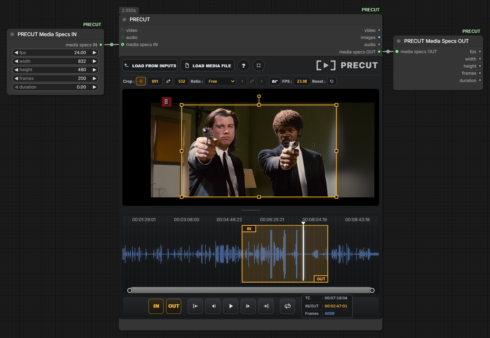

# PRECUT

Edit video and audio directly in ComfyUI. Trim clips, crop and adjust video, then pass the results to the rest of your workflow.



## Main Features

- **Load media:** Open a local video or audio file, or use connected inputs.
- **Trim clips:** Choose IN and OUT points on an interactive timeline with an audio waveform.
- **Adjust video:** Crop, rotate, scale, and change the output frame rate.
- **Preview your edits:** Play, loop, step through frames, and work in fullscreen.
- **Use the results:** Output video, image frames, audio, and media specs.
- **Media Specs nodes:** Set or read frame rate, resolution, frame count, and duration.

## Installation

Clone the repository into your ComfyUI `custom_nodes` folder:

```bash
git clone https://github.com/younestft/PRECUT.git
```

Restart ComfyUI, then find the nodes in the **PRECUT** category.

FFmpeg is required. PRECUT can use `imageio-ffmpeg`, FFmpeg on your system PATH, or a configured `PRECUT_FFMPEG_PATH` / `VHS_FORCE_FFMPEG_PATH`.
